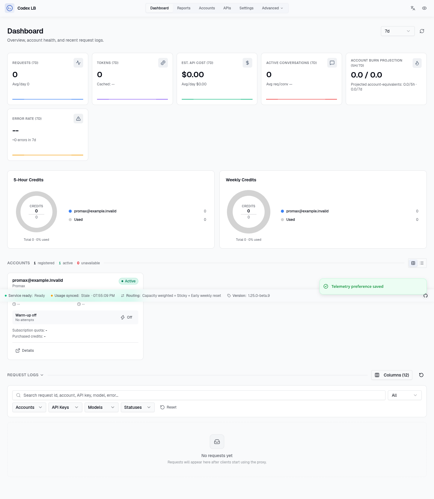
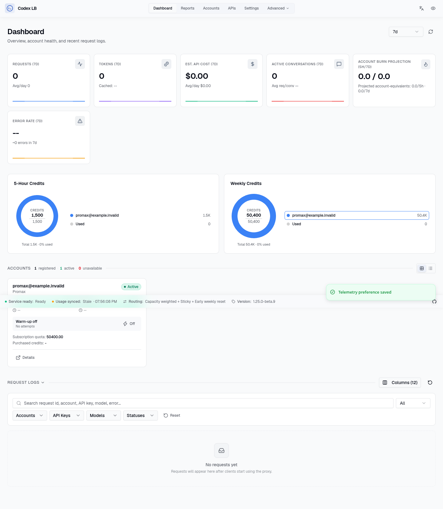

# Pro Max dashboard evidence for codex-lb #2638

Synthetic before/after validation for [Soju06/codex-lb#2638](https://github.com/Soju06/codex-lb/pull/2638), performed by an AI assistant on behalf of `matthematics1137`.

| Revision | 5-hour capacity | Weekly capacity |
| --- | ---: | ---: |
| Parent `72630bbfeee9e3b0d9acfb95e2b1e706b8b0188e` | 0 | 0 |
| PR `77873ef3b109eac1c937d6e505209055974ef72b` | 1,500 | 50,400 |

Both revisions render one synthetic `promax@example.invalid` account with plan `promax`, zero usage, and 300-minute / 10,080-minute usage windows. The account is seeded through the real account/usage repositories into a fresh isolated SQLite database for each revision. No real account, provider request, or credential is used.

The frontend is identical at both revisions (Git tree `540e758e98ead233e2a6a9ca850ecccd0e9a4d7d`). It was built once with the pinned Bun package manager (`bun install --frozen-lockfile`, `bun run build`) and served against each exact backend revision through the repository's `scripts/run_dashboard_browser_smoke.py --backend-fd` route. That standard smoke harness disables background schedulers; the dashboard and its API responses are real, with no API-response mocking. Chromium ran at 1440×1000 in an isolated network namespace with only loopback traffic. Screenshots are unedited full-page browser captures. Both captures had zero browser page errors and zero HTTP errors; both temporary backend processes were stopped afterward.

This demonstrates the PR's dashboard capacity behavior. It does not measure real Pro Max provider limits, replace existing routing tests, or establish that upstream CI has passed. The original PR's author and AI-assistance attribution are unchanged. The screenshots, source revisions, numeric results, and hashes are recorded in `manifest.json`.

Before:

After:

